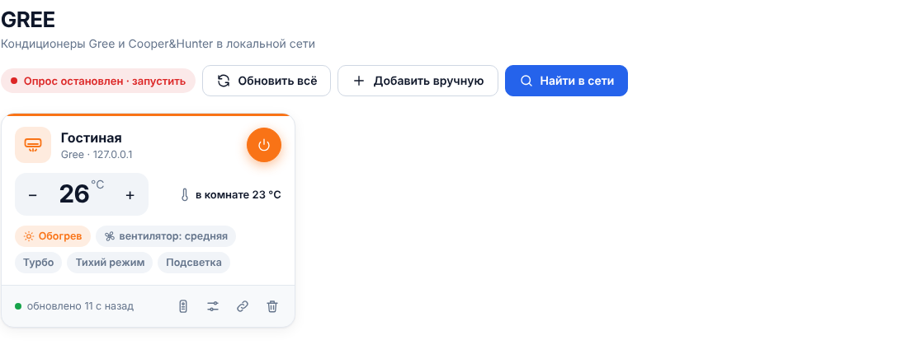
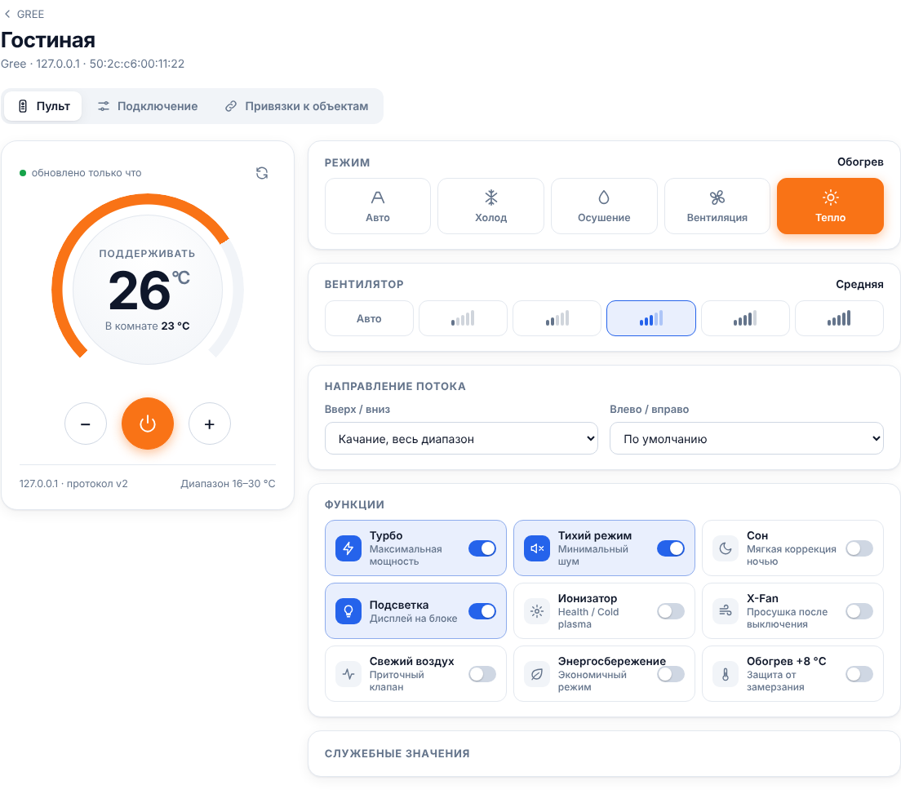

# GREE для MajorDoMo

Модуль [MajorDoMo](https://majordomohome.com/) для управления кондиционерами и
тепловыми насосами Gree и Cooper&Hunter по локальной сети, без облака
производителя.





## Возможности

- Поиск кондиционеров в сети и привязка в один клик, протоколы Gree v1 (AES-ECB)
  и v2 (AES-GCM) определяются автоматически.
- Пульт в панели управления: температура, режимы, скорость вентилятора, жалюзи,
  турбо, тихий режим, сон, подсветка, ионизатор, X-Fan, свежий воздух,
  энергосбережение, дежурный обогрев +8 °C.
- Температура в помещении с датчика внутреннего блока.
- Привязка любого свойства к объектам MajorDoMo в обе стороны.
- Фоновый опрос с настраиваемым интервалом, статус связи по каждому устройству.
- Светлая и тёмная тема панели, адаптивная вёрстка для телефона.

## Поддерживаемые устройства

- кондиционеры Gree с Wi-Fi модулем;
- кондиционеры Cooper&Hunter и другие бренды с Wi-Fi модулем Gree;
- кондиционеры Cooper&Hunter с контроллером Smart Wi-Fi.

## Требования

- MajorDoMo
- PHP 7.0 – 8.4, расширения `sockets`, `openssl`, `json`
- MySQL 5.7+ / MariaDB 10.2+
- кондиционер и MajorDoMo в одной подсети

## Установка из интерфейса MajorDoMo

1. Скачайте `gree.tgz` со [страницы релизов](https://github.com/StealthTZ/majordomo-gree/releases/latest).
2. Панель управления → **Маркет дополнений** → **Добавить/обновить вручную**.
3. Выберите файл `gree.tgz` и нажмите **Загрузить и установить**.

Обновление ставится так же, поверх установленной версии.

## Установка вручную

Скопируйте каталоги `modules`, `templates`, `img` и `scripts` из репозитория в
корень MajorDoMo с сохранением структуры, например:

```
sudo cp -r modules templates img scripts /var/www/html/
```

Все файлы модуля лежат в его собственных каталогах: `modules/gree`,
`templates/gree`, `img/modules/gree.png`, `scripts/cycle_gree.php`. Файлы в корне
системы модуль не создаёт и не меняет.

## Начало работы

1. Откройте панель управления → **Устройства** → **GREE**. При первом открытии
   модуль создаст свои таблицы.
2. Нажмите **Найти в сети** и добавьте найденные кондиционеры. Если поиск ничего
   не нашёл, нажмите **Добавить вручную**, укажите IP и MAC и нажмите
   **Получить ключ**.
3. Управляйте кондиционером на вкладке **Пульт**. На вкладке
   **Привязки к объектам** свяжите нужные свойства с объектами MajorDoMo.

Опрос выполняет цикл `cycle_gree`. Он запускается сам после добавления первого
кондиционера. Если вверху страницы горит «Опрос остановлен», нажмите на надпись
или выполните в консоли MajorDoMo `setGlobal('cycle_greeControl', 'restart');`.

## Свойства

**Gree:** `power`, `ac_mode`, `temperature`, `indoorTemperature`, `fan_speed`,
`fan_direction`, `fan_directionh`, `quiet`, `turbo`, `air`, `blow`, `light`,
`health`, `sleep`, `stht`, `energy_save`, `temptype`, `heatcooltype`, `temrec`.

| Свойство | Значения |
|---|---|
| `power` | 0 выкл, 1 вкл |
| `ac_mode` | 0 авто, 1 охлаждение, 2 осушение, 3 вентиляция, 4 обогрев |
| `temperature` | 16–30 °C |
| `indoorTemperature` | температура в помещении, °C, только чтение |
| `fan_speed` | 0 авто, 1–5 от низкой до высокой (у 3-скоростных блоков 1, 3, 5) |
| `fan_direction` | 0 по умолчанию, 1 качание, 2–6 фиксация сверху вниз, 7–11 качание в зоне |
| `fan_directionh` | 0 по умолчанию, 1 качание, 2–6 фиксация слева направо |
| `quiet` | 0 выкл, 1 авто, 2 вкл |
| `turbo`, `air`, `blow`, `light`, `health`, `sleep`, `stht`, `energy_save` | 0 / 1 |

**Cooper&Hunter Smart Wi-Fi:** `power`, `ac_mode`, `temperature` (16–31 °C),
`fan_speed`, `fan_direction`, `quiet`, `light`, `health`, `sleep`, `eco`, `dry`,
`timing`, `energy_save`, `wdnumber_mode`, `temptype`, `stepless_max`,
`indoorTemperature`.

Свойства только для чтения (`indoorTemperature`, `dry`, `timing`,
`wdnumber_mode`, `temptype`, `heatcooltype`, `temrec`) при записи игнорируются.

## Протоколы

| Устройство | Транспорт | Шифрование |
|---|---|---|
| Gree Wi-Fi (devtype `0x2711`), протокол v1 | UDP 7000 | AES-128-ECB |
| Gree Wi-Fi (devtype `0x2711`), протокол v2 | UDP 7000 | AES-128-GCM |
| Cooper&Hunter Smart Wi-Fi (devtype `0x202`) | поиск UDP 12414, обмен TCP 12416 | нет |

Протокол v2 используется прошивками примерно с 2021 года. Версия определяется
при поиске и при получении ключа; вручную переключается на вкладке **Подключение**.

## Если что-то не работает

- **Кондиционер не находится.** MajorDoMo и кондиционер должны быть в одной
  подсети. Поиск не проходит через гостевую Wi-Fi сеть и при включённой изоляции
  клиентов на точке доступа. Добавьте кондиционер вручную по IP и MAC.
- **Ключ не получается.** Сбросьте настройки Wi-Fi кондиционера с пульта,
  подключите его к сети заново и повторите запрос ключа.
- **Состояние не обновляется.** Проверьте, что вверху страницы горит «Опрос
  работает» и что у кондиционера выбран интервал опроса.

## Описание протокола Gree

- [tomikaa87/gree-remote](https://github.com/tomikaa87/gree-remote)
- [cmroche/greeclimate](https://github.com/cmroche/greeclimate)

История изменений: [modules/gree/CHANGELOG.md](modules/gree/CHANGELOG.md).
Лицензия: MIT, [modules/gree/LICENSE](modules/gree/LICENSE).
